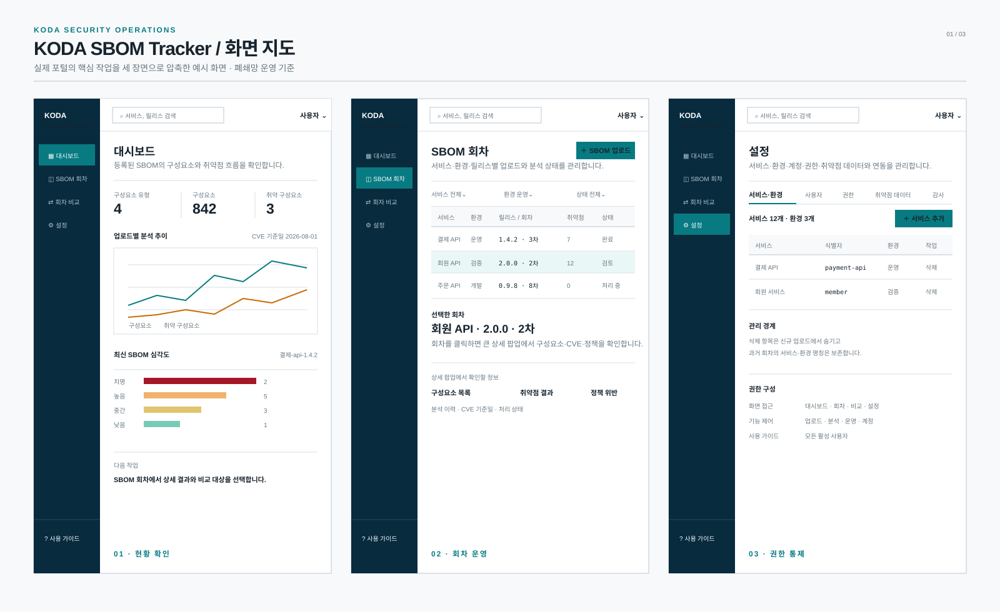

# KODA SBOM Tracker

**폐쇄망에서 운영하는 한국어 SBOM 관리 포털입니다.** 서비스별로 CycloneDX SBOM을
회차 단위로 업로드하면 구성요소와 CVE 취약점, 정책 위반을 분석해 보관하고, 회차 간
변경점을 비교합니다. 인터넷이 없는 서버에서 Docker Compose 한 벌로 동작하도록
이미지·취약점 데이터·백업 도구까지 함께 제공합니다.



## 무엇을 할 수 있나

- **SBOM 회차 관리** — 서비스·환경·릴리스별로 CycloneDX JSON/XML을 업로드하고 분석 상태를 추적합니다.
- **취약점·정책 분석** — Grype DB로 CVE를 분석하고 KODA가 구성요소·심각도·KEV 지표와 SBOM 정책 위반을 직접 산출합니다. CVSS·KEV·제안 버전과 CVE 기준일을 함께 표시합니다.
- **Collection 지표** — 부모별 직접 자식·최신 버전·태그·전체 하위 범위를 집계합니다. 중첩 Collection과 미분석·오래된 결과의 커버리지를 구분합니다.
- **사내 취약점 DB** — 내부 ID·영향 패키지/버전·수정 버전을 등록하고 초안·게시·철회와 변경 이력을 관리합니다. 게시·변경·철회 시 영향 회차를 자동 재분석하며 Grype 결과와 함께 정책·VEX에 적용합니다.
- **고급 정책·검토** — 서비스·환경·릴리스와 동적 계층·태그·최신 버전 범위, CWE·EPSS·달력 AGE·단위별 버전 거리·SPDX를 포함한 표준 CEL 조건, 독립 승인형 VEX와 검토 이력, CycloneDX VEX 가져오기/내보내기를 제공합니다.
- **자동 재분석·알림** — 전체 보관 전 SBOM을 기본 매일 재분석하고 데이터 번들 변경 시 후속 분석을 접수합니다. 결과 변경 보관함과 선택적 서명 Webhook·전송 재시도를 제공합니다. [운영 설정](docs/operations-ko.md#고급-정책vex자동-재분석)을 참조하세요.
- **회차 비교** — 두 회차를 골라 구성요소·취약점·정책 위반 변경점을 탭으로 확인합니다.
- **기존 자료 이관** — 원본 API·번들에서 SBOM·분석·검토·정책을 읽어 변환 검사 후 원자적으로 적용합니다. 원본 변경의 주기 동기화·재시도와 자체 프로젝트 편집도 제공합니다. 미지원 조건은 생략하지 않고 적용을 차단합니다.
- **패키지 최신성** — npm·PyPI·Maven·NuGet·Go·Cargo의 최신 버전·공개 시각을 별도 수집하고 출처·유효기간과 함께 제공합니다. 폐쇄망에서는 캐시를 반입합니다.
- **승인형 계정과 역할 정책** — `admin`·`manager`·`analyst`·`uploader`·`viewer` 역할, 화면 접근 권한과 기능 제어, 감사 로그 CSV를 제공합니다.
- **폐쇄망 운영** — 오프라인 번들, 취약점 데이터 반입·롤백, 백업·복원 스크립트를 포함합니다.

기능과 화면을 더 자세히 보려면 [화면·기능 한눈에 보기](docs/koda-sbom-tracker-overview-ko.md)를 먼저 읽습니다.

## 구성

| 구성요소 | 역할 | 기술 |
| --- | --- | --- |
| `gateway` | 외부 진입점. 경로별 프록시 | nginx |
| `portal-web` | 포털 화면 | React 19 + Vite (`apps/web`) |
| `portal-api` | 업로드·조회·인증 API | FastAPI / Python 3.12+ (`apps/api`) |
| `portal-worker` | SBOM 분석 백그라운드 처리 | 동일 이미지의 worker 모드 |
| `postgres` | 계정·회차·정책·검토·알림을 보관하는 `sbom_tracker` DB | PostgreSQL |
| `portal-data-updater` | 오프라인 취약점 데이터 검증·활성화·롤백 | 동일 API 이미지의 전용 worker |
| `portal-metadata-collector` | 공식 패키지 저장소·EPSS 수집·캐시 갱신 | 동일 API 이미지의 전용 수집기 |
| `portal-project-sync` | 선택적 원본 주기 동기화·재시도 | 동일 API 이미지의 전용 worker |

기본 공개 포트는 `8088`(`PUBLIC_HTTP_PORT`) 하나이며, 경로는 다음과 같습니다.

| 경로 | 화면 |
| --- | --- |
| `/` | 포털 |
| `/api` | 포털 API (명세는 gateway에 공개하지 않고 `portal-api` 내부 `/docs`에서 확인) |

## 빠른 시작

```bash
make env
docker compose build portal-web portal-api portal-worker
docker compose up -d
```

기동 후 `http://127.0.0.1:8088/`을 엽니다. `make help`로 기동·번들·백업·검증
타깃을 확인할 수 있습니다.

`make env`는 데이터베이스·최초 관리자·LDAP 암호화 키를 무작위로 생성하고 `.env`를
권한 `0600`으로 저장합니다. 기본 gateway 바인딩은 `127.0.0.1`입니다. 다른 호스트에서
접속하려면 외부 TLS reverse proxy를 구성한 뒤 `PUBLIC_HTTP_BIND`, HTTPS
`TRACKER_PUBLIC_ORIGIN`, `TRACKER_ENVIRONMENT=production`, `TRACKER_SECURE_COOKIES=true`를
함께 설정해야 합니다.
Grype 분석, 지표 계산, 정책 평가와 회차 비교는 KODA 자체에서 처리합니다.
설정의 **SBOM 정책**에서 심각도·KEV·금지/미확인 라이선스·금지 구성요소 규칙과
만료일 또는 무기한 예외를 관리합니다. 정책 변경은 새 버전으로 저장되며 기존 분석 결과를
덮어쓰지 않습니다. 기존 회차에 적용하려면 **새 분석 리비전**을 실행합니다.
Grype DB와 NVD/KEV 오프라인 데이터의 반입·기준일·롤백 절차는 계속 사용합니다.
정책 미평가·실패는 위반 0건과 구분합니다.
KEV 데이터가 없으면 KEV 정책은 데이터 부족 경고를 남깁니다. 분석 완료와 정책 통과는
별개이며, 기본 정책과 예외는 운영 기준에 맞춰 검토합니다.

기존 시스템의 분석 기록과 정책을 옮길 때는 원본을 보존하고, 식별자·조건·범위·예외의
의미를 확인한 뒤 이관 결과를 검증합니다. 이전 결과가 있다는 사실만으로 현재 정책
평가가 완료된 것으로 표시하지 않습니다. 기능 범위와 확인 기준은
[기능 지원 범위](docs/feature-coverage-ko.md)를 따릅니다.
현재 Docker 인수 결과와 미지원·미검증 범위는 [고급 기능 검증](docs/verification-complete-20261018-ko.md)과 [Java 정규식 추가 검증](docs/verification-java-regex-20261018-ko.md)에 정리했습니다. [구버전 리터럴 이관](docs/verification-literal-20261018-ko.md)과
[Collection·사내 DB 검증](docs/verification-collection-private-20261018-ko.md), [SBOM 정확성 보완](docs/verification-sbom-corrections-20261018-ko.md)과 [외부 플랫폼 대비 미구현·제한 기능](docs/native-parity-audit-ko.md)도 확인하세요.

## 배포 방식

| 방식 | 대상 | 시작 명령 | 가이드 |
| --- | --- | --- | --- |
| Docker Compose | 개발·일반 서버 | `docker compose up -d` | 위 빠른 시작 |
| 폐쇄망 압축파일 | 인터넷 없는 Linux `x86_64` | 빌드 PC에서 `./scripts/build-airgap-release.sh ./dist/koda-sbom-airgap.tar.gz` | [오프라인 번들 가이드](docs/offline-bundle-ko.md) |
| Windows 전체 설치파일 | Docker Desktop(Linux containers) + Inno Setup 6 | `.\scripts\build-windows-installer.ps1` | [Windows 설치파일 가이드](docs/windows-installer-ko.md) |
| Windows Preview 설치파일 | Docker·Node.js 없는 PC (화면 확인용) | `.\scripts\build-windows-preview-installer.ps1` | [Windows 설치파일 가이드](docs/windows-installer-ko.md) |

- 폐쇄망 압축파일에는 포털 소스, compose/deploy/운영 스크립트, 고정 이미지 tar와
  SHA-256 manifest가 들어가며 실제 `.env`는 포함되지 않습니다. 생성 시
  기본적으로 `KODA_RELEASE_SIGNING_KEY`가 필요하고, 설치 전에는 별도 경로로 배포한
  공개키로 detached signature를 검증합니다. 신뢰된 매체에서만 운영자가 명시적으로
  `KODA_ALLOW_UNSIGNED_ARTIFACTS=1`을 지정해 무서명 생성·검증·설치를 선택할 수 있습니다.
- Windows 전체 설치파일(`dist\windows\KODA-SBOM-Tracker-Setup.exe`)은 Compose 스택
  전체를 설치하고 시작 메뉴에서 대시보드를 엽니다.
- Windows Preview(`dist\windows\KODA-SBOM-Tracker-Preview-Setup.exe`)는 PowerShell
  정적 서버와 웹 대시보드만 실행합니다. CycloneDX 파일에 내장된 구성요소·취약점
  레코드만 브라우저 메모리에서 표시하며 Grype·KODA 정책 분석과 영구 저장은
  하지 않습니다. 소스에서 바로 실행하는 개발용 경로는
  `.\scripts\start-windows-preview.ps1 -OpenBrowser`입니다.
- 취약점 데이터만 따로 만들려면 `.\scripts\build-vuln-bundle.ps1`로 Grype DB·NVD·CISA
  KEV bundle ZIP을 만듭니다. ZIP은 서버에서 압축 해제·manifest 검증 후 `vuln-data`
  Docker named volume에 반입하며, 상세 명령은
  [오프라인 번들 가이드](docs/offline-bundle-ko.md)의 Windows 절을 따릅니다.
- 반입·롤백 후에는 포털의 `취약점 데이터` 화면에서 `반입 상태 동기화`를 실행해야
  DB 감사 이력과 활성 기준일이 갱신됩니다.

## 로그인과 권한

최초 Tracker 관리자는 `.env`의 `TRACKER_BOOTSTRAP_ADMIN_USERNAME`과
`TRACKER_BOOTSTRAP_ADMIN_PASSWORD`로 생성합니다. LDAP 연동 전에는 사용자가 로그인
화면에서 로컬 계정 가입을 신청하고, 계정은 `viewer`·`승인 대기` 상태로 생성됩니다.
관리자가 설정의 사용자 화면에서 역할을 정한 뒤 `승인`해야 로그인할 수 있습니다.
로그인 화면은 `아이디`·`비밀번호`를 사용하며 LDAP 사용이 기본 선택됩니다. 로컬
계정 사용자는 LDAP 선택을 해제하고 로그인합니다.
`admin`, `manager`, `analyst`, `uploader`, `viewer`
역할별 권한은 화면의 역할 정책에서 조정할 수 있습니다. 역할 정책 변경과 사용자
승인·상태 변경·삭제는 감사 로그에 남고, 관리자·매니저 계정 변경에는 권한 정책과
마지막 관리 계정 보호 규칙이 함께 적용됩니다. 삭제한 사용자의 세션은 폐기되며 같은
로그인 ID로 다시 가입하면 새 내부 UUID가 발급됩니다.

관리자는 설정의 `LDAP 로그인` 탭에서 서버·TLS·검색 기준 DN·속성·그룹 역할을
입력할 수 있습니다. bind 비밀번호는 `TRACKER_LDAP_ENCRYPTION_KEY`로 암호화해
Tracker DB에 저장하며, LDAP 인증 성공 후 발급된 Tracker 세션을 KODA gateway가
검증하므로 통합 KODA에서도 같은 로그인으로 접근합니다. 실제 운영에서는 StartTLS/LDAPS와
CA 검증을 사용합니다. LDAP 자동 프로비저닝과 그룹별 역할 매핑을 사용하더라도 신규
사용자는 항상 `승인 대기`로 생성되고 관리자 승인 전에는 세션을 발급하지 않습니다. 현재
AI 서버와의 호환이 필요한 경우에만 설정 화면에서 `LDAP 평문 (389)`을 선택할 수 있으며,
자격증명이 평문으로 전달될 수 있으므로 내부망 한정의 임시 호환 모드로 취급합니다.

설정 화면에서는 `tokens.manage` 권한이 있는 사용자만 서비스 범위 API 토큰을 발급하고
폐기할 수 있으며 원문은 발급 시 한 번만 표시됩니다.

## 결과 집계와 삭제 기준

- 화면·집계·회차 비교에는 CVE 식별자로 연결되는 결과만 사용합니다. GHSA가 별칭으로
  CVE에 연결되면 포함하고, CVE에 연결되지 않는 식별자는 원본 분석 기록에만 보존합니다.
- 대시보드의 `취약 구성요소`는 CVE 개수가 아니라 CVE가 하나 이상 있는 고유
  구성요소 수입니다. 회차 목록과 상세의 `취약점`은 CVE 건수입니다.
- 서비스·환경의 `삭제`는 과거 회차 참조를 보존하는 비활성화입니다. 삭제한 항목은
  일반 목록과 새 업로드 선택지에서 숨기지만 기존 회차에는 이름을 계속 표시합니다.
- 회차 `보관`은 목록 상태만 바꾸며, 관리자 전용 `영구 삭제`는 Tracker DB와 로컬
  원본만 제거합니다. 외부에 별도로 보관한 원본과 백업은 제거하지 않습니다.
- 감사 로그는 검색 조건을 유지한 Excel 호환 UTF-8 BOM CSV로 내려받을 수 있습니다.

## KODA 통합

세 제품이 맞물려 도는 전체 프로세스는
[전체 흐름 도식](docs/koda-integration-ko.md#전체-흐름-한눈에-보기)에서 한 장으로 확인합니다.

KODA Linux 통합본에서는 Tracker 로그인 세션을 gateway가 검증해 KODA에 신원만
전달합니다. Tracker에서 승인된 사용자는 KODA에도 자동 활성화되며 KODA 관리자는
프로젝트 권한만 별도로 부여합니다. 이 공유 로그인은 통합
suite의 동일 오리진 `/koda/` 경로에서만 적용되며, 이 저장소의 단독 Compose에는
KODA가 포함되지 않습니다.

KODA와 Tracker에서 실행하는 로그아웃은 모두 현재 브라우저의 Tracker 세션을
폐기합니다. 따라서 어느 한쪽에서 로그아웃해도 양쪽 보호 화면은 다시 로그인이
필요합니다. 계정은 공유하지만 권한 정책은 공유하지 않습니다. Tracker 역할 정책과
KODA 프로젝트 역할은 각각의 관리 화면에서 별도로 설정합니다.

KODA Linux 대시보드에서 결과 화면에 포털 링크를 넣을 때는
`KODA_SSBOM_TRACKER_URL=http://<tracker-host>:8088/?page=runs`를 사용합니다.
포털 회차 ID를 알고 있으면 `?page=runs&runId=<uuid>`를 붙여 해당 회차 상세가
자동으로 열립니다. 이 링크는 브라우저 세션을 우회하지 않으며, 로그인 후에만
회차가 조회됩니다.

## KODA 또는 CI에서 업로드

```bash
export KODA_TRACKER_URL=http://tracker.internal
export KODA_TRACKER_TOKEN='관리자가 발급한 서비스 범위 토큰'
./scripts/upload-sbom.sh <service-id> <environment-id> 1.4.2 ./bom.cdx.json build-20260723-42
```

원본 SBOM은 SHA-256 콘텐츠 주소 저장소에 보존됩니다.

## 문서

| 문서 | 언제 읽나 |
| --- | --- |
| [화면·기능 한눈에 보기](docs/koda-sbom-tracker-overview-ko.md) | 처음 접할 때. 화면 구성과 데이터 흐름 |
| 포털의 `사용 가이드` | 로그인 후 기능과 SBOM·CVE·CVSS·KEV 용어를 빠르게 확인할 때 |
| [운영 가이드](docs/operations-ko.md) | 기동·설정·백업 등 일상 운영 |
| [외부 TLS·DNS 운영 절차](docs/operations-ko.md#2-2-koda-suite-외부-tls-reverse-proxy) | 통합 Suite의 외부 Nginx, 인증서, DNS와 컨테이너 교체 |
| [오프라인 번들 가이드](docs/offline-bundle-ko.md) | 폐쇄망 반입과 취약점 데이터 bundle |
| [KODA 통합 인증·운영 계약](docs/koda-integration-ko.md) | KODA suite와 세션·신원을 공유하거나 GitLab 저장소 결과를 받을 때 |
| [폐쇄망 장애 대응](docs/troubleshooting-ko.md) | 로그인·API 키·업로드 오류가 났을 때 |
| [Windows 설치파일 가이드](docs/windows-installer-ko.md) | Windows 설치파일을 만들거나 설치할 때 |
| [오픈소스 라이선스 정책](docs/open-source-compliance-ko.md) | 산출물을 배포하기 전 |

## 라이선스와 배포 범위

KODA SBOM Tracker 자체 코드는 Apache License 2.0으로 배포합니다. 라이선스 전문과
저작권·서드파티 고지는 [LICENSE](LICENSE), [NOTICE](NOTICE),
[THIRD_PARTY_NOTICES.md](THIRD_PARTY_NOTICES.md)에 있습니다. Docker 없는 Windows Preview는
설치 폴더의 `legal` 디렉터리에 이 파일들과 React·Pretendard 라이선스를 포함합니다.

컨테이너 이미지를 함께 묶는 폐쇄망·오프라인·전체 Windows 패키지는 내부 반입 전용입니다.
고객·협력사·계열사·공개 저장소 등 외부 배포는 대응 소스 제공 절차와 법무 검토가 승인되기
전까지 지원하지 않으며 빌드 스크립트가 외부 배포 범위를 거부합니다.

## 주의

- `.env`에는 실제 비밀번호와 키를 넣고 Git에 커밋하지 않습니다.
- `portal-web`, `portal-api`, `portal-worker`는 모두 `apps/`의 실제 구현을 빌드합니다.
- 모든 서드파티 이미지는 digest까지 고정했습니다. 로컬 빌드 이미지도 오프라인 번들에서 `docker save` 결과와 SHA-256 manifest로 검증합니다.
- 운영 전 `TRACKER_ENVIRONMENT=production`, `TRACKER_SECURE_COOKIES=true`,
  `TRACKER_PUBLIC_ORIGIN=https://<동일-오리진-호스트>`와 TLS 종료 프록시를 사용합니다.
