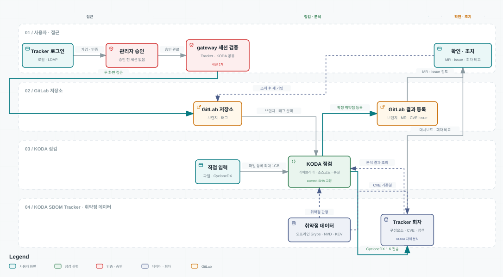

# KODA 통합 인증·운영 계약

KODA와 Tracker를 한 서버에서 함께 운영할 때 두 제품이 계정·세션·권한을 어떻게
나누는지 정의합니다. Tracker 단독 Compose에는 KODA가 포함되지 않으므로 이 문서는
통합 Suite에서만 적용됩니다.

KODA Linux 통합본은 KODA SBOM Tracker를 계정·세션의 단일 원본으로 사용합니다.
두 제품은 같은 HTTPS 오리진에서 서비스되며 KODA의 내부 8765 포트는 호스트에
공개하지 않습니다.

```text
https://<서버>/          KODA SBOM Tracker
https://<서버>/koda/     KODA
```

## 전체 흐름 한눈에 보기



레인은 위에서부터 사용자 접근, GitLab 저장소, KODA 점검, Tracker와 취약점 데이터입니다.
굵은 실선이 주 경로이고 점선은 되돌아오는 조회·판정 경로입니다. 아래 절들은 이 그림의
각 구간을 계약 수준으로 정의합니다.

- **접근** — Tracker 로그인과 관리자 승인을 거친 세션을 gateway가 검증해 두 화면에 전달합니다.
- **입력** — GitLab 브랜치·태그는 실행 직전 commit SHA로 고정하고, 파일 직접 등록 경로도 있습니다.
- **점검·분석** — KODA가 점검한 결과의 CycloneDX를 Tracker가 회차로 보관하고 분석합니다.
- **확인·조치** — GitLab 결과 브랜치·MR·Issue와 Tracker 회차를 확인하고, 새 커밋으로 다시 시작합니다.

취약점 판정은 폐쇄망에 반입된 오프라인 데이터를 사용하므로 결과를 볼 때 CVE 기준일을
함께 확인합니다.

## 로그인과 로그아웃

사용자는 Tracker 로그인 화면에서 로컬 또는 LDAP으로 로그인합니다. LDAP 설정은
Tracker의 관리자 설정에서 저장하고, 통합 gateway는 LDAP 자체를 다시 인증하지 않고
Tracker의 검증된 세션만 KODA에 전달합니다.

신규 로컬 가입과 LDAP 자동 프로비저닝 계정은 모두 Tracker에서 `승인 대기`로
생성됩니다. LDAP 인증에 성공해도 승인 전에는 세션이 발급되지 않으며, 관리자가
역할을 확인하고 승인한 뒤 다시 로그인해야 KODA에도 접근할 수 있습니다.

gateway는 보호된 KODA 요청마다 Tracker의 `GET /api/v1/auth/session`으로 쿠키
세션을 확인합니다. 이 endpoint는 Bearer 토큰을 받지 않으며 성공할 때만 UUID,
세션 만료 시각, 표시 이름을 응답 헤더로 제공합니다. gateway는 브라우저가 임의로
보낸 인증·신원 헤더를 제거하고 검증된 값만 KODA에 전달합니다.

KODA와 Tracker의 로그아웃은 모두 `POST /api/v1/auth/logout-current`를 호출해
현재 브라우저의 서버 세션을 폐기합니다. 어느 한쪽에서 로그아웃해도 양쪽 보호
화면은 다시 로그인이 필요합니다.

## 계정과 권한

계정 UUID와 활성 상태는 Tracker가 관리합니다. KODA는 이 UUID를 별도 비밀번호
없이 사용하며, 처음 본 계정은 `pending`으로 등록합니다.

권한은 사이트별로 독립적입니다.

- Tracker: 역할 정책으로 Tracker 화면과 SBOM 업로드·분석·설정 기능을 제어합니다.
- KODA: 시스템 관리자 여부와 프로젝트 멤버십 역할로 KODA 화면과 기능을 제어합니다.
- KODA 보안·품질 점검 규칙: KODA 시스템 관리자만 변경합니다.
- 일반 KODA 사용자: 허용된 프로젝트에서 검사 기준과 기준 범위만 선택합니다.

Tracker의 관리자·매니저 정책과 KODA의 마지막 활성 시스템 관리자는 각각 제거
방지 규칙을 적용합니다.

Tracker에서 사용자를 삭제하면 현재 세션과 계정 행이 제거됩니다. 같은 로그인 ID로
다시 가입해도 새 UUID가 발급되므로 이전 KODA 프로젝트 멤버십을 자동으로 승계하지
않고 KODA 관리자가 새 계정의 권한을 다시 확인합니다.

## 운영과 장애 동작

운영에서는 `TRACKER_ENVIRONMENT=production`, `TRACKER_SECURE_COOKIES=true`,
`TRACKER_PUBLIC_ORIGIN=https://<서버>`를 사용하고 앞단 TLS 종료기가 원래 Host와
HTTPS scheme을 보존해야 합니다.

Tracker 인증 확인이 실패하거나 시간 초과되면 gateway는 KODA 보호 화면과 API를
`503`으로 실패시킵니다. 이전 인증 결과를 캐시하거나 KODA를 익명으로 열지
않습니다. KODA에서 이미 시작된 분석 작업은 KODA 저장소와 worker 상태에 따라
계속 처리되며, 인증 복구 후 같은 계정·프로젝트 권한으로 조회합니다.

상태 확인 경로만 인증 예외입니다.

| 경로 | 확인 대상 |
| --- | --- |
| `/healthz` | gateway |
| `/api/v1/healthz` | 포털 API |
| `/koda/live` | KODA 프로세스 |
| `/koda/ready` | KODA 저장소·worker와 Tracker health를 함께 확인 |

통합 압축파일 생성과 설치는 KODA 저장소의
`platforms/linux/suite/README.ko.md`를 따릅니다.

KODA 자체 분석·정책·검토 화면에는 Tracker 세션과 역할 권한을 적용합니다.
흰 화면·인증·업로드 문제는 [폐쇄망 장애 대응](troubleshooting-ko.md)을 따릅니다.

## GitLab 기반 KODA 결과 수신

KODA가 GitLab 저장소 점검을 완료하면 CycloneDX JSON을 Tracker의
`POST /api/v1/sbom-runs`로 전송합니다. GitLab 저장소 하나를 Tracker 서비스 하나에
대응시키며, 소스코드 취약점 결과는 보내지 않고 해당 회차에서 생성한 CycloneDX
SBOM만 전송합니다. Tracker는 GitLab PAT를 저장하거나 GitLab에 직접 접속하지
않습니다. GitLab 결과 브랜치·Merge Request·Issue 작성은 KODA가 담당합니다.
Tracker의 직접 SBOM 업로드 회차도 GitLab에 게시하려면 KODA 게시 경로를 호출하는
별도 연동이 필요하며, Tracker 설정 화면에 GitLab URL/PAT를 추가하는 것만으로는
기능이 생기지 않습니다. `runUrl`은 Tracker 회차 조회 링크이며 GitLab Issue URL이
아닙니다. 저장소별 서비스 토큰은 발급 시 원문을 한 번만 반환하고 재프로비저닝하면
이전 토큰을 회전(폐기)합니다. 동일 `Idempotency-Key` 재전송은 같은 회차를 반환합니다.

### Tracker 준비

Tracker와 KODA가 함께 읽는 프로비저닝 비밀값 파일을 하나 준비하고 Tracker API에는
`TRACKER_KODA_PROVISIONING_TOKEN_FILE`, KODA에는
`KODA_TRACKER_PROVISIONING_TOKEN_FILE`로 같은 파일을 읽기 전용 연결합니다. 통합
Suite는 최초 시작 시 실행 계정 전용 파일을 자동 생성하고 설치된 Tracker `.env`에
경로를 기록합니다.

KODA 관리자가 저장소를 연결하면 `POST /api/v1/integrations/koda/repositories`가
다음을 한 트랜잭션으로 처리합니다.

1. GitLab URL과 프로젝트 ID로 결정한 저장소별 Tracker 서비스를 생성하거나
   기존 항목을 활성화·재사용합니다.
2. 공용 `gitlab-source` 환경을 생성하거나 재사용합니다.
3. 해당 서비스에만 업로드할 수 있는 전송 토큰을 새로 발급하고 이전 자동 토큰은
   폐기합니다.
4. 서비스 UUID, 환경 UUID와 토큰 원문을 KODA에 한 번 반환합니다. KODA는 UUID와
   토큰 파일 참조만 DB에 보관하고 토큰 원문은 권한 `0600` 파일로 저장합니다.

관리자가 Tracker 화면에서 서비스 UUID·환경 UUID·토큰을 복사해 KODA에 입력할
필요는 없습니다. 자동 생성된 서비스와 `gitlab-source` 환경은 `설정 > 서비스·환경`
및 `설정 > 연동 설정`에서 확인할 수 있습니다.

통합 Suite에서는 Tracker gateway와 KODA가 전용 `koda-dashboard` 네트워크를
공유하므로 `http://koda-sbom-gateway:8080`으로 호출합니다. Compose 프로젝트명을
바꾸면 gateway 이름도 같이 바꿉니다. 프로비저닝 비밀값은 읽기 전용으로, KODA의
서비스 토큰 디렉터리는 실행 계정 전용 읽기·쓰기로 마운트합니다.

### 전송 계약

KODA는 Bearer 토큰으로 다음 값을 `multipart/form-data` 요청에 보냅니다.

| 항목 | 값 |
| --- | --- |
| URL | `POST /api/v1/sbom-runs` |
| `serviceId` | 저장소 전용 Tracker 서비스 UUID |
| `environmentId` | `gitlab-source` 환경 UUID |
| `releaseVersion` | 태그명 또는 `브랜치명@commit-SHA-앞12자리` |
| `note` | KODA 회차 ID, GitLab 저장소 경로, 전체 commit SHA |
| `sbom` | KODA 회차에서 생성한 CycloneDX JSON |
| `Idempotency-Key` | `koda:<KODA 회차 ID>:<SBOM SHA-256>` |

서비스 토큰은 발급할 때 지정한 서비스로만 업로드할 수 있습니다. 다른 서비스 UUID,
비활성 서비스 또는 비활성 환경을 지정하면 Tracker가 요청을 거부합니다. 같은 토큰과
같은 `Idempotency-Key`로 재전송하면 기존 Tracker 회차를 반환하므로 중복 회차가
생기지 않습니다.

KODA는 서비스 토큰으로 `GET /api/v1/integrations/koda/runs/{runId}`를 조회합니다.
토큰에 연결된 서비스의 회차만 조회할 수 있으며 응답에는 회차 상태, 최신 CVE
projection, CVSS·KEV·제안 버전과 정책 결과가 포함됩니다. 다른 서비스의 회차는
존재 여부를 노출하지 않고 `404`를 반환합니다.

### 상태, 재전송과 토큰 교체

Tracker 전송은 일시 오류를 최대 세 번 재시도합니다. 이후 KODA는 분석 완료를 제한
시간 동안 조회하고 GitLab 결과 게시까지 성공해야 연동 상태를 `completed`로 기록합니다.
실패 시 Tracker 회차 ID와 오류를 보존하므로 사용자는 KODA 결과 화면에서 같은
`Idempotency-Key`로 재시도할 수 있습니다. KODA는 commit SHA별 결정적 결과 경로와
브랜치를 사용하고 기존 MR·Issue를 조회해 재사용하므로 같은 회차를 재시도해도 GitLab
항목이 중복되지 않습니다.
