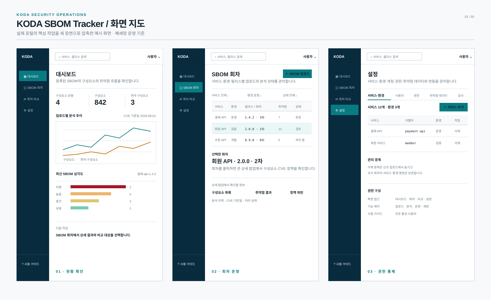
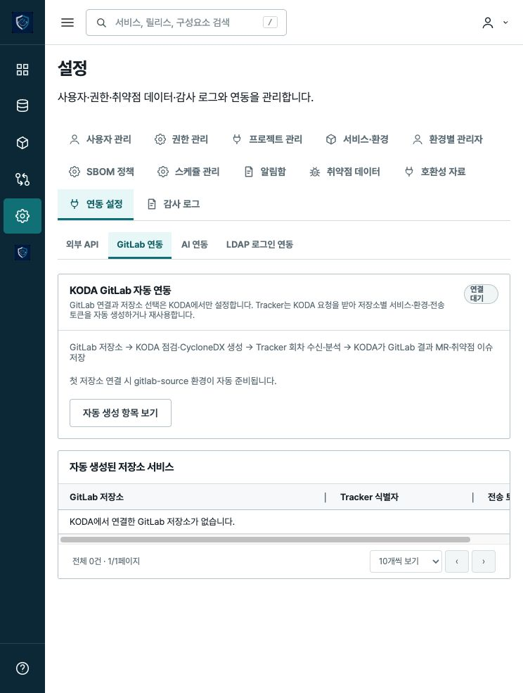
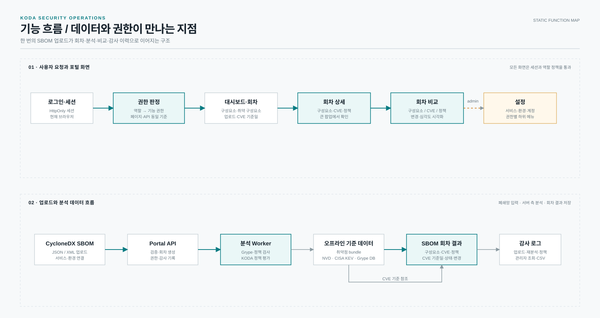

# KODA SBOM Tracker 화면·기능 한눈에 보기

이 문서는 처음 접하는 운영자가 KODA SBOM Tracker의 화면 구성과 데이터 흐름을
빠르게 이해하도록 만든 안내도입니다. 실제 포털의 메뉴·권한·회차 모델을 기준으로
작성했으며, 화면 예시는 설명을 위한 정적 그림입니다.

## 화면 예시

### 1. 대시보드

최신 SBOM의 구성요소 유형·구성요소·취약 구성요소·KEV를 한눈에 확인합니다.
`취약 구성요소`는 CVE 수가 아니라 CVE가 하나 이상 있는 고유 구성요소 수입니다.
업로드별 추이의 각 지점에는 회차·서비스·환경·값·CVE 기준일이 표시됩니다.

### 2. SBOM 회차

서비스·환경·릴리스·회차 단위로 업로드와 분석 상태를 관리합니다. 회차를 클릭하면
큰 상세 팝업에서 구성요소, CVE 기준일, 취약 구성요소, 정책 위반을 확인합니다.
회차 목록·상세·분석 리비전의 **취약 구성요소**는 발견이 하나 이상 연결된 SBOM 구성요소를
회차별로 한 번씩 셉니다. 분석이 끝나지 않은 회차는 **미평가**로 표시합니다.
취약점 검사기에는 개별 발견 건수가 표시되며, 표에서 CVE·심각도·구성요소·CVSS·KEV·제안 버전을 확인할 수 있습니다.
회차 정보는 상단에 있고, 아래 카드는 제목을 눌러 접고 펼칩니다. 구성요소·취약점 검사기와 근거 표는 기본 10행부터 조회할 수 있습니다.
구성요소 검사기의 **+ 추가**는 현재 회차 검사기에 수동 항목을 등록합니다. 이름 칸의 **수정**으로 표에서 바로 편집할 수 있고, 삭제한 항목은 **삭제된 항목**에서 복원합니다. 완료된 회차의 PURL 없는 원본 구성요소는 오른쪽의 **후보 조회**를 눌러 CPE 후보를 확인할 수 있습니다.
[구성요소 검사기 안내](library-cve-environment-admin-ko.md#구성요소-수동-추가수정)
**오프라인 CPE 평가 범위**에서는 수집기가 보고한 SBOM 수집 범위와 NVD 구성요소
대조 결과를 확인합니다. Oracle Listener 발견의 **Oracle Home 증거**에는 해당 Home의
RU, OPatch 인벤토리와 수집 근거 SHA-256이 표시될 수 있습니다. [오프라인 CPE 평가](offline-cpe-ko.md)

완료 회차의 **Java/Maven 버전 영향 검토**에서 배포 기준과 의존 경로를 확인합니다.
**폐쇄망 후보 버전 일괄 검토**에서는 Java/Maven, Python, Linux C/ELF 후보별
조건 판정과 빌드·실행 기록을 봅니다. 후보 SBOM에 일치하는 반입 자료가 있으면
**공식 출처·근거** 열에 기관, 선언 근거, 원본 URL, SHA-256을 표시합니다.
분석 결과가 있는 회차에서는 공통 AI 설정을 사용해 요약을 생성할 수 있습니다.
[폐쇄망 후보 버전 일괄 검토](offline-upgrade-ko.md)

### 3. 설정

설정 탭은 권한에 따라 표시합니다. 전체 관리자 화면의 순서는 **사용자 관리 → 권한 관리 → 프로젝트 관리 → 서비스·환경 → 환경별 관리자 → SBOM 정책 → 스케쥴 관리 → 알림함 → 취약점 데이터 → 호환성 자료 → 연동 설정 → 감사 로그**입니다.
권한 관리는 메뉴 진입을 정하는 **화면 접근 권한**과 화면 안 작업을 정하는 **기능 제어**로 나뉩니다.
전체 관리자 외 사용자에게 SBOM을 보여 주려면 **환경별 관리자**에서 담당 환경을 지정하고 역할에 SBOM 조회 권한을 부여합니다.
[환경별 조회 범위](library-cve-environment-admin-ko.md#환경-관리자-지정)
사이드바 최하단의 `사용 가이드`는 활성 사용자라면 역할과 관계없이 볼 수 있습니다.
**스케쥴 관리**의 **전체 분석 스케쥴**에서 SBOM 재분석 주기와 범위를 설정하고 실행 이력을 봅니다. **호환성 자료**에서는 폐쇄망 후보 검토에 사용할 자료를 반입합니다. [스케쥴 운영](operations-ko.md#고급-정책vex자동-재분석) · [호환성 자료 반입](official-compatibility-data-ko.md)

**연동 설정** 아래에는 권한에 따라 다음 네 탭이 표시됩니다.

| 탭 | 할 수 있는 일 |
| --- | --- |
| 외부 API | 서비스·환경 범위와 유효 기간을 정해 조회 토큰을 발급하거나 폐기합니다. [외부 API 안내](integrations-java-ai-ko.md#외부-사이트에서-tracker-조회) |
| GitLab 연동 | KODA와의 연결 상태, 자동 생성된 저장소 서비스, 전송 토큰 상태를 봅니다. 저장소 선택은 KODA에서 합니다. [GitLab 연동 안내](koda-integration-ko.md#gitlab-기반-koda-결과-수신) |
| AI 연동 | KODA와 Tracker가 함께 쓰는 사내 AI의 주소, 모델, API 키를 등록하고 연결을 시험합니다. [공통 AI 안내](integrations-java-ai-ko.md#koda와-tracker-공통-ai) |
| LDAP 로그인 연동 | LDAP 접속 정보, 사용자 검색, 그룹·역할 매핑을 설정합니다. [LDAP 운영 안내](operations-ko.md#2-1-계정과-권한-초기화) |

**취약점 데이터**에서 서명된 통합 자료를 검증하고 적용합니다. 상단 **활성 CVE 기준일**은
현재 승인된 NVD 자료의 날짜이며, 각 분석 리비전에는 분석 당시의 기준일이 기록됩니다.
[통합 취약점 자료 운영](unified-vulnerability-data-ko.md)

### 4. 서비스·환경과 삭제

서비스·환경은 설정에서 관리합니다. 화면의 `삭제`는 과거 회차의 이름과 참조를
보존하는 비활성화이며, 삭제한 항목은 일반 목록과 새 업로드 선택지에서 숨깁니다.
사용자 삭제는 세션과 계정 행을 제거하고, 회차 영구 삭제는 Tracker DB와 로컬 원본만
제거합니다. 외부에 별도로 보관한 원본과 백업은 제거하지 않습니다.

### 5. 표시 기준

회차·라이브러리·CVE 검색 목록은 기본 10개씩 표시합니다. 표 아래에서 10·25·50·100개씩 보기와 페이지 번호를 선택할 수 있습니다. 상세 표는 이전·다음으로 이동하며, 행 수 선택이 있는 표에서는 같은 옵션을 사용합니다.

검색창으로 키보드 포커스를 옮기면 청록색 테두리가 나타납니다. 탭에 포커스를 둔 상태에서 좌우 방향키로 이웃 탭을, Home·End로 첫 탭과 마지막 탭을 선택합니다.

시각은 DB에 UTC로 저장하되 화면과 감사 CSV에서는
`Asia/Seoul`의 `YYYY-MM-DD HH:mm:ss` 형식으로 보여줍니다. 회차 비교의 `정책 위반`은
선택한 두 분석 결과 사이에서 KODA 정책 결과가 추가·해소·변경된 내역입니다.

## 기능 흐름

핵심 흐름은 다음과 같습니다.

1. 사용자가 로그인하면 HttpOnly 세션과 역할 정책으로 화면·API 권한을 함께 판정합니다.
2. 허용된 사용자가 서비스·환경을 선택하고 CycloneDX JSON/XML을 SBOM 회차로 업로드합니다.
3. Portal API가 입력과 회차를 검증하고, 분석 Worker가 Grype와 폐쇄망 취약점 데이터,
   KODA 정책 엔진으로 구성요소·취약점·정책 결과를 만듭니다. 원본 결과는
   보존하고 화면·집계·비교에는 CVE로 연결되는 결과만 동일하게 투영합니다.
4. 저장된 회차는 상세 팝업에서 확인하고, 두 회차를 선택하면 구성요소·CVE·정책
   위반 탭으로 변경점을 비교합니다.
5. 사용자·역할 정책 변경, 취약점 데이터 반입 동기화, 업로드·분석·삭제 같은 작업은
   감사 로그로 남고, 허용된 관리자는 검색 결과를 Excel 호환 CSV로 내려받습니다.
6. 사이드바의 `KODA 보안 분석` 아이콘은 동일 오리진의 `/koda/`를 새 브라우저 탭으로 엽니다.

이 문서는 Tracker 내부 흐름을 다룹니다. KODA·GitLab과 맞물린 전체 프로세스는
[KODA 통합 인증·운영 계약의 전체 흐름 도식](koda-integration-ko.md#전체-흐름-한눈에-보기)에 있습니다.

## 권한 경계

| 영역 | 일반 사용자 | 관리자·허용 역할 |
| --- | --- | --- |
| 대시보드·SBOM 회차 | 화면 접근 권한에 따라 조회 | 업로드·재분석·보관 등 기능 권한에 따라 수행 |
| 회차 비교 | 비교 조회 권한이 있을 때 | 동일 |
| 설정의 서비스·환경 | `services.view` 또는 설정 접근 권한으로 조회 | `catalog.manage`로 추가·변경·삭제 |
| 취약점 데이터 | 관리자이면서 조회 권한이 있을 때 | `vulnerability.manage`로 동기화·활성화 |
| 감사 로그 | 관리자이면서 `audit.view`가 있을 때 | 검색·Excel 호환 CSV 다운로드 |
| 사용자·권한 관리 | 해당 기능 권한이 있을 때 | 승인·삭제·역할 정책 조정 |
| 사용 가이드 | 모든 활성 사용자 | 동일 |

## 문서와 화면을 함께 유지하는 기준

- 메뉴나 권한 이름을 바꾸면 이 문서의 화면 예시와 권한 표를 함께 수정합니다.
- 제품 사이의 흐름이 바뀌면 `docs/diagrams/koda-suite-process.svg`도 함께 고칩니다.
  생성 방법은 [docs/diagrams/README.md](diagrams/README.md)에 있습니다.
- 회차 결과에 SHA-256 원문이나 운영 비밀값을 예시 데이터로 넣지 않습니다.
- 화면 변경 후에는 `apps/web`에서 `npm test`, `npm run typecheck`, `npm run lint`,
  `npm run build`를 실행해 문서에 설명한 기본 흐름이 깨지지 않았는지 확인합니다.

표현 방식은 [diagram-design](https://github.com/cathrynlavery/diagram-design)의
편집형 원칙인 낮은 정보 밀도, 제한된 강조색, 그림자 없는 구조를 참고했습니다.
